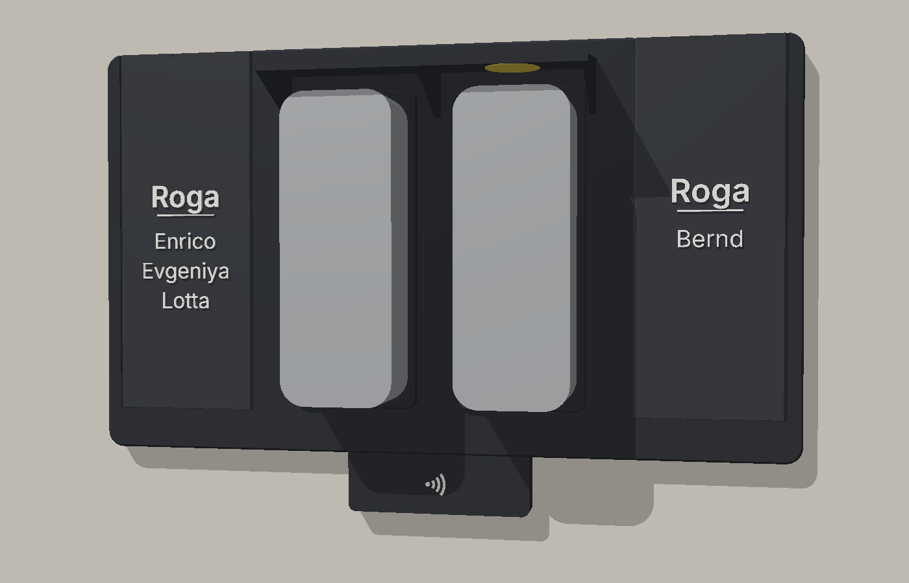
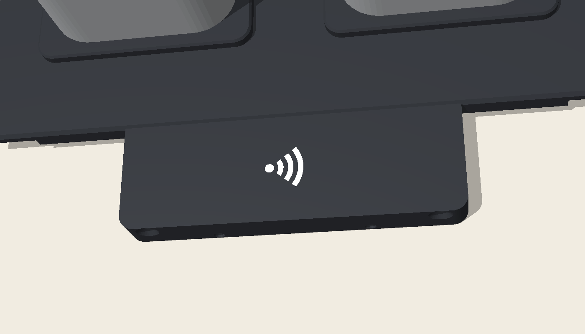
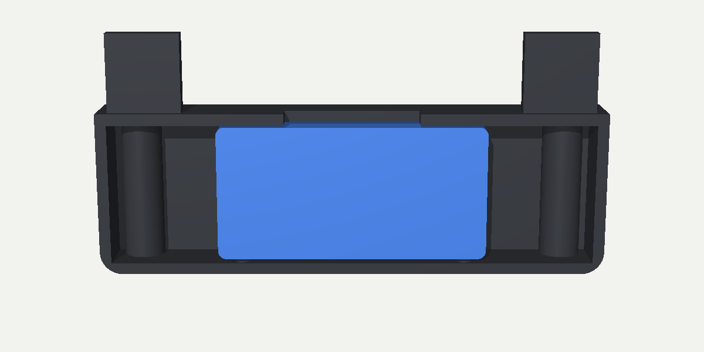

# Zutrittsmodul für die Ring-Doppelplatte

Zusätzlicher Zugang zur Haustür per **RFID-Karte/Chip** und **Handy**, z. B. für Putzhilfe oder Besuch mit Zeitfenster. Das ekey bionyx und der Schlüssel bleiben **unverändert**.

- **Die fertige Platte bleibt, wie sie ist.** Nichts muss neu gedruckt werden, auch die geklebten Seitenteile und 5-mm-Abstandshalter bleiben.
- **RFID:** kleiner **Sockel unter der Platte** (90 × 29 mm), mittig unter den Klingeln, Front bündig mit der Platte. Darin sitzt nur der Leser, vorn ist nur ein Kontaktlos-Symbol zu sehen. Er wird mit 2 Schrauben von unten in die Plattenkante geschraubt.
- **Handy:** NFC-Aufkleber **unter dem Dach** eingeklebt, das Handy wird oben aufs Dach gelegt. Kein Druckteil, kein Kabel.
- **Eine Bohrung, ein Kabel.** Klingeln und Leser hängen zusammen an einem 8-adrigen Fernmeldekabel durch die Ring-Bohrung in der Mitte. Die Leser-Adern laufen hinter der Platte nach unten in den Sockel, nichts ist sichtbar.
- **Die Tür öffnet nur Home Assistant.** Der Leser meldet nur „Karte XY gescannt“. HA prüft Karte und Zeitfenster und schaltet den Shelly, der parallel zum ekey-Relais am Motorschloss hängt. Am Sockel lässt sich nichts kurzschließen.
- **Rückmeldung:** keine Lichtleiste. Wenn die Tür aufgeht, surrt das Motorschloss, und bei jedem Öffnen oder Ablehnen kommt eine Push-Nachricht aufs Handy.
- **Ohne Löten:** Fertiges Modul mit Grove-Stecker, Verbindungen über Wago-Klemmen und Dupont-Buchsen.

---

## Was geht und was nicht

| Wunsch | Lösung |
|---|---|
| RFID | ✅ 13,56-MHz-Karten und -Chips (MIFARE Classic, NTAG). Keine 125-kHz-Chips. |
| Handy | ✅ NFC-Aufkleber unter dem Dach + Home-Assistant-App (iPhone und Android), alternativ Knopf in der App |
| Apple/Google Wallet | ❌ Wallet-Schlüssel brauchen von Apple bzw. Google zertifizierte Leser. Mit Bastel-Hardware nicht sauber machbar. |
| Codeeingabe | ⏳ Ausbaustufe 2, siehe unten |
| HA-Steuerung | ✅ Leser ist ein ESPHome-Gerät. Die Logik (wer, wann) kommt in das spätere HA-Projekt. Ein Grundgerüst liegt in [`homeassistant/beispiel_automation.yaml`](homeassistant/beispiel_automation.yaml). |
| Störung WLAN/Kamera | ✅ keine. RFID und NFC arbeiten auf 13,56 MHz, WLAN auf 2,4/5 GHz. Die Ring-Klingeln und der Leser stören sich nicht gegenseitig. |

---

## Teileliste

### Elektronik

| Teil | Anzahl | ca. Preis | Hinweis |
|---|---|---|---|
| **M5Stack AtomS3 Lite** (ESP32-S3) | 1 | 16 € | sitzt **innen**, 24 × 24 × 9,5 mm |
| **M5Stack Unit RFID2** (WS1850S) | 1 | 10 € | 48 × 24 × 8 mm, I²C, Lesereichweite < 20 mm |
| Grove-auf-Dupont-Kabel, **Buchse**, 20 cm | 2 | 4 € | 1 × außen (Leser), 1 × innen (Atom) |
| Wandler **24 V → 5 V, USB-C-Ausgang, Schraubklemmen-Eingang** | 1 | 8 € | Eingang bis mind. 28 V, max. ca. 50 × 25 × 15 mm |
| USB-C-Kabel kurz (15–20 cm, gewinkelt ideal) | 1 | 5 € | Wandler → Atom |
| Feinsicherungshalter inline 5 × 20 + Sicherung **0,5 A träge** | 1 | 4 € | vor dem Wandler |
| **Wago 221-414** | 2 | 2 € | +24 V und GND verteilen |
| Hohlstecker-Adapter Buchse 5,5 × 2,1 → Schraubklemme | 1 | 2 € | Netzteil rein |
| NFC-Aufkleber, siehe [unten](#nfc-aufkleber-für-das-dach) | 1 (+Reserve) | 1 € / Stk | |
| RFID-Karten oder -Schlüsselanhänger 13,56 MHz | nach Bedarf | 1 € / Stk | für Putzhilfe, Besuch |

Netzteil: das **Mean Well GST36E24** aus der Ring-Anleitung (24 V / 1,5 A). Reicht für beide Klingeln (max. 0,84 A) plus Zutrittsmodul (ca. 0,1 A).

### Installation

| Teil | Hinweis |
|---|---|
| **J-Y(St)Y 4×2×0,6**, Länge Wand + 1 m | **das einzige Kabel** nach außen: 4 Adern Klingeln + 4 Adern Leser, Ø ca. 6 mm. Ersetzt das 2×2-Kabel aus der Ring-Anleitung. Wer später eine Tastatur nachrüsten will: **6×2×0,6** nehmen, dann bleiben 4 Adern Reserve. |
| **Eine** Wandbohrung **10 mm** + Leerrohr | die Ring-Bohrung in der Mitte, nur 2 mm größer (falls schon mit 8 mm gebohrt: aufbohren). Gefälle nach außen, beidseitig Silikon |
| Schrumpfschlauch 6 mm, ca. 10 cm + 2–3 mm für die Dupont-Buchsen | bündelt die Leser-Adern hinter der Platte |
| **2 × Schraube 3,0 × 40 Senkkopf, Edelstahl** | Sockel von unten in die Plattenkante |
| dünnes doppelseitiges Klebeband (ca. 0,1 mm) | hält den Leser im Sockel |
| 2 × Schraube 4 × 30 + Dübel, 4 × Blechschraube 2,9 × 13 | Inneneinheit an die Wand, Deckel |

Gegenüber der [Haupt-Anleitung](../README.md#stromversorgung-optional-dauerbetrieb-statt-akkuwechsel) ändert sich nur: 4×2 statt 2×2 Adern, 10 statt 8 mm Bohrung, und die Aufputzdose entfällt (der Verteiler sitzt jetzt in der Inneneinheit).

---

## NFC-Aufkleber für das Dach

Das Handy liest den Aufkleber durch die 3 mm Kunststoff des Dachs. Worauf es ankommt:

| | Empfehlung | Warum |
|---|---|---|
| Chip | **NTAG213** oder **NTAG215** (original NXP) | Die HA-App schreibt eine kurze Adresse, dafür reichen 144 Byte (NTAG213). Funktioniert mit iPhone und Android. |
| Größe | **rund 25–30 mm** | größere Antenne = mehr Reichweite durch das Dach. Kleiner als 20 mm nicht nehmen. |
| Material | **PET** mit **3M-Kleber**, Temperatur bis mind. 70 °C | Das dunkle Dach wird in der Sonne 60–70 °C warm, Papier-Aufkleber lösen sich bei Feuchtigkeit. |
| Falls die Klingel stört | **„Anti-Metall“ / „On-Metal“**-Variante | Hat eine Ferritschicht auf der Rückseite, die das Feld vom Gerät darunter abschirmt. Die Ferritseite zeigt nach unten (zur Klingel), die Klebeseite ans Dach. |

Bewährte Beispiele (keine Werbung, nur zur Orientierung):
- [GoToTags NFC Sticker NTAG215, 25 mm rund](https://store.gototags.com/nfc-sticker-ntag215-25-mm-circle/) (PET, −25 bis 70 °C, ca. 0,60 $/Stk ab 10 Stück)
- [NFC-Aufkleber Anti-Metall 25 mm, NTAG213, mit 3M-Kleber, 10er-Pack](https://www.ebay.de/itm/146372509630) (ca. 11 €)

Kauf am besten **beide Sorten** im 10er-Pack, sie kosten fast nichts, und teste vor Ort, welcher zuverlässiger durchs Dach liest.

**Einkleben:**
1. Aufkleber **vorher** mit der HA-App beschreiben (*Einstellungen → Tags → Tag hinzufügen → Schreiben*).
2. Mit Tesa probeweise unter das Dach halten und das Handy oben auflegen. Probier ein paar Stellen aus.
3. Beste Stelle: **über einer Klingel, möglichst weit vorn zur Dachkante** (größter Abstand zur Klingel-Elektronik, leicht zu treffen). In der Mitte sitzt die Stützwange.
4. Dachunterseite mit Isopropanol entfetten, Aufkleber fest andrücken.
5. Optional oben auf dem Dach ein kleines Handy-Symbol (Aufkleber) als Markierung.

Hinweis iPhone: Beim iPhone liegt die NFC-Antenne oben am Gerät. Also mit der Oberkante aufs Dach tippen, nicht flach in der Mitte.

---

## Druckteile

Alle Dateien liegen in [`stl/`](stl/). Erzeugt mit `python3 scripts/generate.py` (Sockel) und `python3 zutritt/scripts/generate_innen.py` (Inneneinheit). Die Platte bleibt unverändert.

| Datei | Farbe | Hinweis |
|---|---|---|
| `sockel_zutritt.stl` + `sockel_zutritt_symbol.stl` | Platte (Anthrazit) + **Weiß** | als **ein** Objekt laden, Symbol = Filament 2. Ohne AMS: nur `sockel_zutritt.stl`, das Symbol ist dann vertieft. |
| `innen_unterteil.stl` | **PETG weiß** | liegt mit dem Boden aufs Bett, keine Stützen |
| `innen_deckel.stl` | **PETG weiß** | Außenseite liegt unten (Beschriftung ist gespiegelt vertieft) |
| `innen_niederhalter.stl` | PETG weiß | **2 ×** drucken, hält je einen Mean-Well-Wandler fest |

**Sockel drucken:** **PETG** wie die Platte (sitzt unter der Platte, nicht unterm Dach).

| Einstellung | Wert |
|---|---|
| Lage | **stehend**, so wie die STL liegt (Unterseite aufs Bett, Zungen zeigen nach oben, Front senkrecht) |
| Wände | 4 |
| Infill | 30 % |
| Stützen | **aus**. Der Deckel des Sockels ist eine 9-mm-Brücke, das schafft jeder Drucker. |
| Brim | **an, 5 mm** (schmale Standfläche) |
| Schichthöhe | 0,16 mm (sauberes Symbol) |

---

## Montage

### 1. Die eine Bohrung

Es bleibt bei der **Ring-Bohrung mittig hinter dem Mittelteil**, nur mit **10 mm** statt 8 mm. Leerrohr rein, das **J-Y(St)Y 4×2×0,6** durchziehen, beidseitig mit Silikon abdichten.

### 2. Kabel außen aufteilen

Das Kabel kommt in der runden Aussparung hinter dem Mittelteil aus der Wand. Dort den **Mantel absetzen** (ca. 2 cm vor der Wand), ab hier laufen Einzeladern:
- **Paar 1 + 2** wie bisher durch die beiden Kabeldurchführungen zu den Klingeln.
- **Paar 3 + 4** (die 4 Leser-Adern) mit Schrumpfschlauch bündeln und **senkrecht nach unten** hinter der Platte bis unter die Unterkante führen (ca. 11 cm). In der Mitte liegt kein Abstandshalter im Weg, die 5 mm Luft reichen.

**Adernzuordnung J-Y(St)Y 4×2×0,6.** SDA und SCL sind jeweils mit einer Versorgungsader verdrillt, das hält den I²C-Bus auf der Leitung stabil. Die Aderfarben unterscheiden sich je nach Hersteller, also die eigenen Farben in die letzte Spalte schreiben und innen wie außen gleich anklemmen.

| Paar | Signal | außen an | innen an | Farbe (dein Kabel) |
|---|---|---|---|---|
| 1a | +24 V | Ring links + | Wago +24 V | |
| 1b | GND | Ring links – | Wago GND | |
| 2a | +24 V | Ring rechts + | Wago +24 V | |
| 2b | GND | Ring rechts – | Wago GND | |
| 3a | SDA | RFID2 gelb | Atom Grove gelb (G2) | |
| 3b | GND | RFID2 schwarz | Atom Grove schwarz | |
| 4a | SCL | RFID2 weiß | Atom Grove weiß (G1) | |
| 4b | 5 V | RFID2 rot | Atom Grove rot | |

### 3. Sockel bestücken

1. Grove-auf-Dupont-Kabel in den Leser stecken. **Dupont-Buchsen direkt auf die 0,6-mm-Adern** schieben (sitzt stramm), mit Schrumpfschlauch sichern.
2. Leser mit **dünnem** Doppelklebeband **mit der Vorderseite** mittig an die Innenseite der Front kleben. Der Grove-Stecker liegt in der Lücke daneben.
3. Adern durch den Durchlass oben in der Mitte nach oben führen.

### 4. Sockel an die Platte

1. Sockel von unten an die Platte schieben. Die beiden **Zungen** gleiten hinter die Platte, die Oberkante liegt an der Plattenunterkante an, die Front ist bündig.
2. Mit **2,0 mm** durch die beiden Schraubdome von unten ca. 12 mm in die Plattenkante vorbohren. Der Dom dient dabei als Bohrführung, gerade halten.
3. 2 × **3,0 × 40 Senkkopf** von unten eindrehen, handfest.

Ist die Platte schon an der Wand, geht das genauso, nur von unten.

**Regen:** Oben ist der Sockel von der Platte abgedeckt, die Front ist geschlossen. Falls trotzdem Wasser an der Wand herunterläuft, läuft es durch die 2 Löcher im Boden ab.

### 5. Inneneinheit (Version 2: ein Netzteil, Mean-Well-Wandler)

Gehäuse **229 × 137 × 39 mm**, flach, weiß gedruckt. Jedes Teil hat seine eigene Aufnahme, nichts liegt lose:

| Aufnahme | Teil | Befestigung |
|---|---|---|
| links unten | **Mean Well SD-15B-5** (24 → 5 V, Atom) | Eckwinkel + Niederhalter mit 2 Schrauben 2,9 × 13 |
| links oben | **Mean Well SD-15B-12** (24 → 12 V, Tastatur) | Eckwinkel + Niederhalter mit 2 Schrauben 2,9 × 13 |
| Mitte, Spalte 1 | 3 × **WAGO 221-415**: `24V+`, `24V-`, `GND` | eindrücken, Rastnasen |
| Mitte, Spalte 2 | 5 × **WAGO 221-413**: `D0 a/b`, `D1 a/b` (Spannungsteiler), `frei` | eindrücken, Rastnasen |
| rechts oben | **AtomS3 Lite** (USB-C oben frei zum Flashen, Grove unten) | eindrücken, Rastnasen |
| rechts unten | **Delock 65524** (DC-Buchse an der Kabelkerbe) | eindrücken, Rastnasen |
| rechts | Öffnung **Ø 22 mm** über der Wandbohrung (Cat 7 von hinten) | 3 Kabelbinder-Brücken |

Die Klemmen der Wandler zeigen zur Mitte, zu den Wagos. Die Leitereinführungen der Wagos zeigen nach links. Die Aufnahmen sind im Boden beschriftet.

**Lage an der Wand:** Die Wandbohrung liegt **204 mm vom linken** und **44 mm vom unteren Außenrand**. Gehäuse mit 2 Schrauben 4 × 30 befestigen (Senklöcher im Boden), Deckel mit 4 Blechschrauben 2,9 × 13.

**Vor dem Druck prüfen:** Maße der Wagos (221-413: ca. 17,6 × 18,8 mm, 221-415: ca. 26,6 × 18,8 mm), des Delock (27 × 18 × 15 mm) und der SD-15 (78 × 51 × 28 mm). Alle stehen oben in `zutritt/scripts/generate_innen.py`, Spiel 0,5 mm.

**Verdrahtung (Mean-Well-Variante):**
1. **24 V:** Netzteil GST60A24 → Delock-Buchse → Wago `24V+` und `24V-`. Von dort gehen ab: das Klingel-Paar im Cat 7, der Eingang des SD-15B-12 und der Eingang des SD-15B-5.
2. **12 V:** SD-15B-12 `+V` → Ader +12 V zur Tastatur. `-V` → Wago `GND`.
3. **5 V:** SD-15B-5 `+V` → rote Grove-Ader (5 V) am Atom. `-V` → Wago `GND`.
4. **GND-Wago (gemeinsame Masse):** Minus beider Wandler, schwarze Grove-Ader (Atom), GND-Ader zur Tastatur, untere Widerstände der Spannungsteiler.
5. **D0/D1:** über die Spannungsteiler (`D0 a/b`, `D1 a/b`) an G1/G2 des Atom, nur falls die Tastatur mehr als 3,3 V liefert. Vorher messen.
6. Netzteilkabel durch die Kerbe unten, mit Kabelbinder an der Brücke sichern.

**Vor dem Einschalten:** An beiden Wandler-Ausgängen 5 V bzw. 12 V messen, erst dann Atom und Tastatur anschließen. Beim Flashen per USB-C die 5-V-Ader vom Wandler abklemmen.

---

## ESPHome

Konfiguration: [`esphome/haustuer-zutritt.yaml`](esphome/haustuer-zutritt.yaml), Secrets-Vorlage: [`esphome/secrets.example.yaml`](esphome/secrets.example.yaml). Geprüft mit ESPHome 2026.9.

1. Datei ins ESPHome-Add-on kopieren, Secrets eintragen.
2. Ersten Flash per USB-C am Rechner, danach geht alles per WLAN.
3. Das Gerät erscheint in HA. In der ESPHome-Integration beim Gerät unter *Optionen* **„Gerät darf Home-Assistant-Aktionen ausführen“** einschalten, sonst kommen die Karten-Scans nicht an.
4. Karte vorhalten → unter *Einstellungen → Tags* erscheint die Karte. Dort einen Namen geben („Putzfrau“).

---

## Sicherheit

- **Kein Öffnen ohne HA.** Fällt HA oder das WLAN aus, gehen Finger (ekey) und Schlüssel trotzdem.
- **Karten-ID ist kopierbar.** Der Leser wertet nur die Seriennummer (UID) aus, wie fast alle günstigen Leser. Deshalb in HA:
  - **Zeitfenster** pro Karte (Putzhilfe nur Mo–Fr 7–14 Uhr)
  - **Push bei jedem Öffnen** und bei Ablehnung
  - verlorene Karte in HA einfach aus der Liste nehmen
- Der **Shelly** sitzt innen, weit weg. Er ist das Einzige, das die Tür öffnet.
- **Handy-Aufkleber:** Die ID ist egal, jeder darf sie kopieren. HA prüft, **welches Handy** gescannt hat (`device_id`), und das geht nur mit angemeldeter HA-App.

---

## Ausbaustufe 2: Codeeingabe

Ein fertiges **MPR121-Touch-Tastenfeld 3 × 4** (ca. 38 × 79 mm, I²C) hängt am selben I²C-Bus wie der Leser, braucht also keine weiteren Adern. Es braucht aber einen eigenen, höheren Sockel. Achtung: Kapazitive Tasten ohne Dach lösen bei Regen fehl aus (falscher Code, also ungefährlich).

---

## Vor dem Druck prüfen

- **Grove-Buchse am Leser:** Laut Plan sitzt sie an der kurzen Seite (links, von vorn gesehen). Falls nicht, `RFID` in `scripts/generate.py` verschieben.
- **Pinbelegung AtomS3 Lite** (G1/G2 am Grove) am Gerät gegenprüfen.
- **Wandler-Maße:** Das Gehäuse hat Platz für ca. 50 × 25 × 15 mm.
- **Abstandshalter:** Der Sockel ist für die geklebten **5 mm** gebaut. Bei anderen: `config/namen.json` → `"zutritt": {"abstandshalter_mm": 5}` ändern und neu erzeugen.

---

> **Archiv-Hinweis:** Dieser Ordner stammt aus dem Branch `zutrittsmodul` des Repositorys *ring-doorbell-doppelplatte-mit-namen*. Der Sockel wurde dort von `scripts/generate.py` mit erzeugt; diese Änderungen (plus `config/namen.json` und der Verweis im Haupt-README) liegen als [`scripts/ring-repo-aenderungen.patch`](scripts/ring-repo-aenderungen.patch) bei und lassen sich dort bei Bedarf mit `git apply` wieder einspielen.
