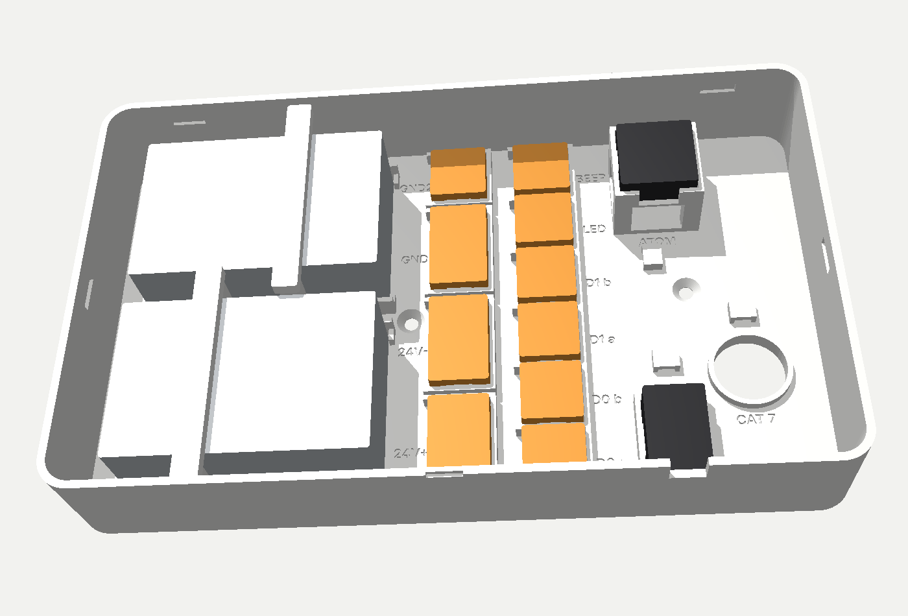
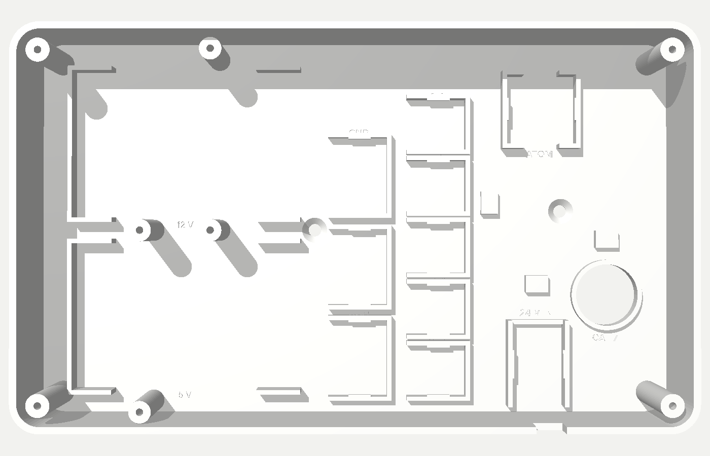
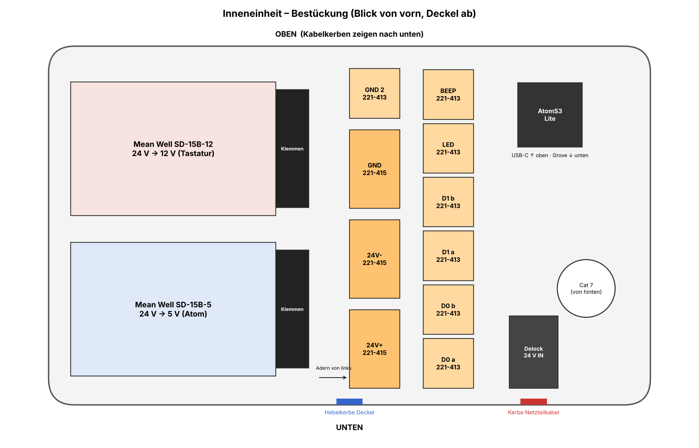

# Hardware

Außen eine **Wiegand-Tastatur mit Kartenleser**, innen eine flache **Inneneinheit** mit Netzteil-Verteilung und dem **AtomS3 Lite**. Dazwischen **eine Bohrung, ein Cat-7-Kabel**, das auch die Ring-Klingeln versorgt. Der **Shelly** sitzt am Motorschloss parallel zum ekey-Relais; ekey und Schlüssel bleiben unverändert.

## Teileliste

| Teil | Anzahl | Hinweis | Bezug (Beispiele) |
|---|---|---|---|
| **UHPPOTE Wiegand-Tastatur 13,56 MHz**, 12 V, wetterfest (ASIN B01GJDNTP4) | 1 | Karte + PIN, Ausgang Wiegand 26/34 | Amazon |
| **M5Stack AtomS3 Lite** (ESP32-S3) | 1 | Leser-Elektronik innen | M5Stack, Berrybase, Eckstein |
| Grove-Kabel mit offenen Enden (oder Grove-auf-Dupont, Buchse) | 1 | Atom → Wagos | |
| **Mean Well GST60A24-P1J** (24 V / 2,5 A, Steckernetzteil) | 1 | **das eine Netzteil** für Ring + Tastatur + Atom | Reichelt, Conrad, Bürklin, TME (**nicht** Amazon/eBay: Fälschungen) |
| **Mean Well SD-15B-12** (DC/DC 18–36 V → 12 V) | 1 | Tastatur | Conrad (ca. 13 €), Bürklin 62C2001, TME |
| **Mean Well SD-15B-5** (DC/DC 18–36 V → 5 V) | 1 | Atom | wie oben |
| **DC-Einbaubuchse DC-099, 5,5 × 2,1 mm**, mit Litzen (ca. 10 cm), Gewinde ca. 10,7 mm (M11) | 1 | Netzteil GST60A24 wird von außen eingesteckt | z. B. RUNCCI-YUN K12 (DC-099, 30 V / 10 A); **nicht** 5,5 × 2,5 mm, **nicht** Delock 65503 (0,5 A). Loch 11,2 mm |
| **WAGO 221-415** (5 Klemmstellen) | 3 | `24V+`, `24V−`, `GND` | Elektro-Fachhandel, Reichelt, Conrad |
| **WAGO 221-413** (3 Klemmstellen) | 7 | `GND 2`, `D0 a/b`, `D1 a/b`, `LED`, `BEEP` | wie oben |
| Schottky-Diode **BAT85** (DO-35) | 2 | LED/BEEP der Tastatur schalten, schützt den Atom | Reichelt, Conrad |
| Dupont-Kabel **Stecker–Buchse**, 10–20 cm | 2 | Atom G5/G6 → Diode | |
| Schrumpfschlauch 1,5–2 mm | 10 cm | über Diode + Dupont-Buchse | |
| Widerstand **10 kΩ**, ¼ W, bedrahtet | 4–8 | Spannungsteiler D0/D1 (nur falls nötig, siehe unten) | |
| **Cat 7 Verlegekabel** (S/FTP, 4 × 2 × AWG23) | Wand + 1 m | das einzige Kabel nach außen | |
| 13,56-MHz-Karten / Schlüsselanhänger (MIFARE) | nach Bedarf | | |
| Shelly Plus/Pro 1 (oder Mini Gen3) mit potentialfreiem Kontakt | 1 | parallel zum ekey-Relais (falls nicht schon vorhanden) | |

## Ein Kabel, eine Bohrung: Belegung Cat 7

| Ader | Signal | außen | innen |
|---|---|---|---|
| orange | Ring + | Ring-Klingeln | Wago `24V+` |
| weiß-orange | Ring − | Ring-Klingeln | Wago `24V−` |
| grün | +12 V | Tastatur rot | SD-15B-12 `+V` |
| weiß-grün | GND | Tastatur schwarz | Wago `GND` |
| blau | D0 | Tastatur D0 (grün) | Wago `D0 a` |
| braun | D1 | Tastatur D1 (weiß) | Wago `D1 a` |
| weiß-blau | LED | Tastatur **blau** (LED) | Wago `LED` |
| weiß-braun | BEEP | Tastatur **gelb** (BEEP) | Wago `BEEP` |

Aderfarben laut Anleitung (Modell **HBK-D02K**, so von Amazon für die UHPPOTE-Tastatur bereitgestellt): rot +12 V, schwarz GND, grün D0, weiß D1, blau LED, gelb BEEP, grau Wiegand-34-Auswahl. Liegt eine andere Anleitung bei: immer danach gehen.

**LED und Summer:** Laut Anleitung zeigt die Tastatur Grün bzw. Töne nur, wenn LED und BEEP vom Controller angesteuert werden (Ruhe: LED rot). Ohne Anschluss bleibt sie also stumm – ob auch der Tastenton entfällt, zeigt erst das Gerät. Eine eigene Einstellung für den Summer hat das Modell nicht.

**Wiegand 34 einstellen:** **graue und schwarze Ader verbinden** (Standard ab Werk ist Wiegand 26). Mit 26 Bit überträgt sie nur einen Teil der Karten-ID.

**Masse:** Minus von SD-15B-12, SD-15B-5, Atom und Tastatur liegen gemeinsam auf dem Wago `GND`. Der Ring-Kreis (24 V) bleibt davon getrennt, weil die SD-15B galvanisch trennen. Die Ring-Klingeln brauchen 24 V und hängen direkt am Netzteil.

## Spannungsteiler D0/D1 (ohne Löten)

Der Atom verträgt an G1/G2 **höchstens 3,3 V**. Vorher mit dem Multimeter messen: Tastatur an 12 V, **D0 gegen GND** im Ruhezustand.

| gemessen | Teiler (je Signal) | ergibt |
|---|---|---|
| ≤ 3,3 V | keiner, Ader direkt an den Atom | |
| **≈ 5 V** | 1 × 10 kΩ **oben** (Ader → Atom), 2 × 10 kΩ **unten** (Atom → GND, in Reihe) | 3,3 V |
| **≈ 12 V** | 3 × 10 kΩ **oben** (in Reihe), 1 × 10 kΩ **unten** | 3,0 V |

So geht das in den Wagos: Wago `D0 a` = Ader von außen + oberer Widerstand. Wago `D0 b` = anderes Ende des oberen Widerstands + unterer Widerstand + Grove-Ader zum Atom. Freies Ende des unteren Widerstands in den Wago `GND`. Reihenschaltungen: Widerstandsbeinchen zusammen in einen freien Steckplatz desselben Wago stecken bzw. verdrillen. Für D1 genauso.

## Inneneinheit

Gehäuse **229 × 137 × 39 mm**, flach, **PETG weiß**. Jedes Teil hat seine Aufnahme, nichts liegt lose:

| Aufnahme | Teil | Befestigung |
|---|---|---|
| links unten | **SD-15B-5** (24 → 5 V, Atom) | Eckwinkel + 2 Eckanschläge an der Klemmenseite + Niederhalter, 2 Linsenkopf-Blechschrauben 2,9 × 13 (ISO 7049, Senkkopf geht auch) |
| links oben | **SD-15B-12** (24 → 12 V, Tastatur) | Eckwinkel + 2 Eckanschläge an der Klemmenseite + Niederhalter, 2 Linsenkopf-Blechschrauben 2,9 × 13 (ISO 7049, Senkkopf geht auch) |
| Mitte, Spalte 1 | 3 × **WAGO 221-415**: `24V+`, `24V−`, `GND`, dazu 1 × **221-413** `GND 2` | eindrücken, Rastnasen |
| Mitte, Spalte 2 | 6 × **WAGO 221-413**: `D0 a/b`, `D1 a/b`, `LED`, `BEEP` | eindrücken, Rastnasen |
| rechts oben | **AtomS3 Lite** auf 16-mm-Podest (USB-C oben, Grove unten, darunter Platz für 2 Dupont-Stecker an G5/G6) | auf Eckauflagen, Rastnasen |
| unten, links neben 24V+ | **DC-Einbaubuchse** im Loch Ø 11,2 mm (Gewinde gemessen 10,73 mm) | von außen durchstecken, innen mit Mutter kontern (Wand innen auf 4 mm verstärkt) |
| rechts | Öffnung **Ø 22 mm** über der Wandbohrung (Cat 7 von hinten) | Kabelbinder-Brücken |

Die Aufnahmen sind im Boden beschriftet.

**Lage an der Wand:** Wandbohrung **204 mm vom linken** und **54 mm vom unteren Außenrand**. Gehäuse mit 2 Schrauben 4 × 30 + Dübel.

**Deckel zum Aufschnappen:** 6 Rasthaken (je 2 an den Längsseiten, je 1 an den Schmalseiten) rasten in Nuten der Gehäusewand ein. Gerade aufsetzen und rundum andrücken. Öffnen: einen Schlitzschraubendreher in die Kerbe unten in der Mitte stecken, leicht drehen, dann den Deckel rundum abziehen.

**Druckteile** ([`inneneinheit/stl/`](inneneinheit/stl/)):

| Datei | Hinweis |
|---|---|
| `innen_unterteil.stl` | Boden aufs Bett, keine Stützen |
| `innen_unterteil_schrift.stl` | **optional, zweite Farbe (AMS):** die Bodenbeschriftung als eigenes Teil. Zusammen mit `innen_unterteil.stl` in Bambu Studio laden, Frage „als ein Objekt mit mehreren Teilen laden“ mit **Ja** beantworten, dem Teil „Schrift“ z. B. Schwarz zuweisen. Fertig kombiniert: `innen_unterteil_2farbig.3mf`. |
| `innen_deckel.stl` | Außenseite unten, Rasthaken zeigen nach oben – keine Stützen nötig |
| `innen_niederhalter.stl` | **2 ×** drucken |

Neu erzeugen (Maße oben im Skript, Spiel 0,5 mm): `python3 hardware/inneneinheit/generate_innen.py` (braucht `trimesh`, `shapely`, `manifold3d`, `fonttools`). Vorschau-Bilder: `python3 hardware/inneneinheit/vorschau.py`.

**Entwurf V2.1, noch nicht mit echten Teilen geprüft:** erst in PLA probedrucken und Wagos, Wandler, DC-Buchse und Atom einsetzen. Unklar ist vor allem, wo genau die Buchsen an der Atom-Unterseite sitzen; das Podest hat nur 4 × 4 mm Eckauflagen, die Mitte ist frei. Beschriftung im Boden: Spalte 1 links neben den Wagos, Spalte 2 rechts dahinter.

**Vor dem Druck nachmessen:** Wagos (221-413 nachgemessen ca. 18,6 mm breit, 221-415 hochgerechnet 29,6 mm; Datenblatt nennt 18,8 bzw. 29,9 mm, real sind sie schmaler). Zum schnellen Prüfen: `test_wago_aufnahme.stl`. Die Wandler-Klemmleiste ragt ca. 12,5 mm über das Blechgehäuse hinaus (90,5 mm gesamt); dahinter sind 14,5 mm Platz für die Adern bis zu den Wagos, SD-15 (78 × 51 × 28 mm).

## Verdrahtung Schritt für Schritt

1. **24 V:** GST60A24 → DC-Einbaubuchse (von außen eingesteckt) → Litzen in Wago `24V+` / `24V−`. Von dort: Ring-Paar (orange/weiß-orange), Eingang SD-15B-12, Eingang SD-15B-5.
2. **12 V:** SD-15B-12 `+V` → grüne Ader (Tastatur +12 V). `−V` → Wago `GND`.
3. **5 V:** SD-15B-5 `+V` → rote Grove-Ader (Atom 5 V). `−V` → Wago `GND`.
4. **GND-Wagos:** `GND` und `GND 2` mit einem kurzen Drahtstück verbinden. `GND`: Minus beider Wandler, schwarze Grove-Ader, weiß-grüne Ader (Tastatur GND), Brücke. `GND 2`: Brücke, untere Widerstände der Spannungsteiler, 2 Plätze Reserve.
5. **D0/D1:** blau → `D0`, braun → `D1`, ggf. über die Teiler, dann an **G1 (D0)** und **G2 (D1)** des Atom.
6. **LED/BEEP (erst nach dem Messen anschließen):** weiß-blaue Ader + **Anode** einer BAT85 (Seite ohne Ring) in den Wago `LED`. Auf die **Kathode** (Seite mit Ring) eine Dupont-Buchse stecken, Schrumpfschlauch drüber, Stecker in **G5** am Atom. Genauso weiß-braun → Wago `BEEP` → BAT85 → **G6**. Der Atom zieht die Leitung über die Diode auf GND (= LED grün bzw. Piep); bei 3,3 V sperrt die Diode, die 5 bzw. 12 V der Tastatur erreichen den Atom nicht.
7. Netzteilkabel durch die Kerbe, mit Kabelbinder sichern.

**Vor dem Einschalten:** An den Wandler-Ausgängen 12 V bzw. 5 V messen, erst dann Tastatur und Atom anklemmen. **Beim Flashen per USB-C die 5-V-Ader vom Wandler abklemmen.**

## Shelly

Der Shelly-Kontakt (O/I bzw. potentialfrei) kommt **parallel zum Kontakt des ekey-Relais** am Motorschloss-Eingang. Er schaltet einen 1-s-Impuls (`Switch.Set` mit `toggle_after`). Shelly mit Passwort, Zugriff per Firewall nur von HA und dem Atom (siehe [`../adnet_access/DOCS.md`](../adnet_access/DOCS.md)).

### Deckel mit Logo

Logo, „AD.NET solutions“ und „ACCESS“ sind mittig untereinander 0,6 mm in die Außenseite eingraviert (einfarbig, z. B. alles weiß). Die Außenseite liegt beim Druck auf dem Bett; die Vertiefungen werden überbrückt, Brückeneinstellungen von Bambu Studio passen. Erhaben ginge nur mit Stützmaterial.

Für späteres Einfärben gibt es die passenden Einlagen als eigene STLs: `innen_deckel_einlage_logo_grau.stl`, `innen_deckel_einlage_logo_orange.stl` (1 mm tief), `innen_deckel_einlage_schrift.stl`. In Bambu Studio alle vier Dateien zusammen importieren und bei der Frage „als ein Objekt mit mehreren Teilen laden“ mit **Ja** bestätigen, dann sitzen sie exakt in den Vertiefungen.

### Optionale Kabelverschraubung (z. B. eigenes Kabel zur Ring)

Drei vorgeprägte Bohrstellen (außen Kreis Ø 12,2 mm, Wand bleibt 0,8 mm dick und dicht): **rechte Seite unten**, **Oberseite rechts**, **Unterseite rechts**. Bei Bedarf mit Stufenbohrer auf 12 mm aufbohren und eine **Kabelverschraubung M12 × 1,5** (Klemmbereich ca. 3–6,5 mm, Gegenmutter innen) einsetzen. Innen ist an allen drei Stellen Platz für die Mutter.

### Temperaturfühler (optional)

Innen am Deckel, über dem Gang zwischen den beiden Wago-Spalten, sitzen zwei Klemmen für einen **DS18B20 im Edelstahlröhrchen Ø 6 mm**: einfach von oben einklipsen. Ein nackter DS18B20 (kleines schwarzes Gehäuse mit 3 Beinchen) kommt in ein Stück Schrumpfschlauch oder wird mit einem Kabelbinder durch den Schlitz unter einer Klemme gebunden. Kabel zum Atom (G7, 3,3 V, GND) etwa 25 cm lang lassen, damit der Deckel zum Öffnen abgelegt werden kann. Firmware: `esphome/adnet/gehaeusetemperatur.yaml`.

### Innenverkabelung: Adern und Belegung

Litze: Adern aus einem Stück Steuerleitung **YSLY-JZ 10 × 0,75 mm²** (feindrähtig, schwarz mit aufgedruckten Nummern + grün-gelb). 1 m Leitung = 10 Adern à 1 m, reicht für die ganze Inneneinheit. Mantel abziehen, Adern einzeln verwenden; Stücke so schneiden, dass eine Nummer sichtbar bleibt (sonst Enden mit Edding beschriften). Abisolieren 11 mm, Aderendhülsen bei Wago 221 nicht nötig.

| Ader | Funktion |
|---|---|
| grün-gelb | GND / alle Minus (bei 24 V gibt es keinen Schutzleiter) |
| 1 | 24 V + |
| 2 | 24 V − |
| 3 | 12 V + (Tastatur) |
| 4 | 5 V + (Atom) |
| 5 | D0 |
| 6 | D1 |
| 7 | LED |
| 8 | BEEP |
| 9 | Reserve |

**Zum Atom** passen die 0,75er-Adern nicht in die Buchsen. Stattdessen:

| Atom | Signal | Kabel |
|---|---|---|
| Grove G1 | D0 | Grove-Kabel, ein Ende abgeschnitten, Adern in die Wagos |
| Grove G2 | D1 | Grove-Kabel |
| Grove 5V | 5 V + | Grove-Kabel |
| Grove GND | GND | Grove-Kabel |
| G5 | LED (über BAT85) | Dupont-Kabel, ein Ende abisoliert |
| G6 | BEEP (über BAT85) | Dupont-Kabel |
| G7 | Temperatur DS18B20 (optional) | Dupont-Kabel |

Dünne Dupont-/Grove-Adern (ca. 0,14 mm²) im Wago: 11 mm abisolieren und doppelt umlegen oder Aderendhülse 0,25 mm².

**Belegungsschild zum Einkleben** (innen in den Deckel): `belegung_schild.stl` (Schrift vertieft) und `belegung_schild_schrift.stl` (passende Einlage für zweifarbigen Druck). 70 × 108 × 1,6 mm, Schrift 3 mm hoch. Platz innen am Deckel über dem Atom/rechten Wagos (von innen gesehen links neben den Fühlerklemmen), mit doppelseitigem Klebeband.
